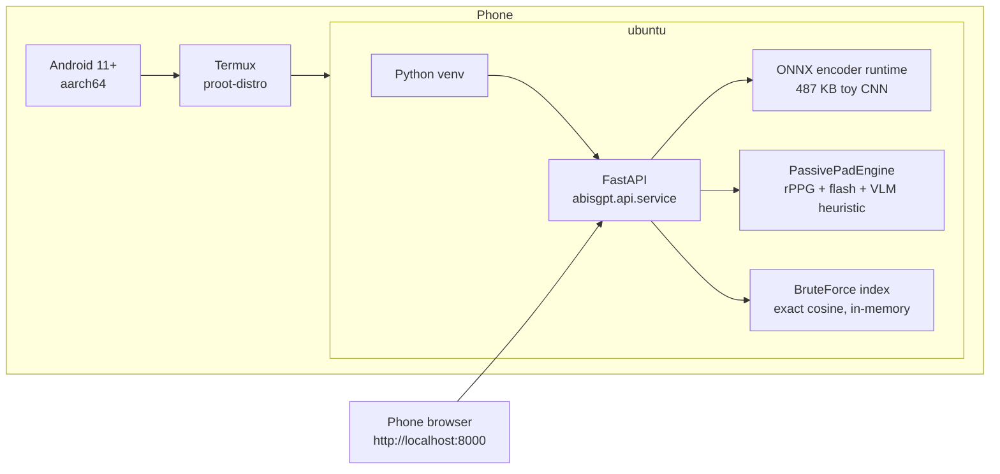

# ABISGPT on Android — fully on-device biometric server

The complete stack (ONNX encoder → PAD → two-tier matcher → FastAPI →
browser console) runs **on the phone itself**: no laptop, no cloud backend,
no data ever leaves the device — the strongest privacy story the white
paper's GDPR-by-architecture promise supports.



## Why these choices on-device

| Concern | On-device answer |
| --- | --- |
| Vector search at phone scale | `brute` backend: exact cosine over a NumPy matrix. Galleries here are tens of identities, so ANN machinery (HNSW/PQ, GPU) buys nothing — brute is *faster* at this scale and exactly Tier-2-precise. Faiss GPU (`[gpu]` extra) and Faiss CPU stay server-side options, not phone options. |
| Encoder | Same 487 KB ONNX toy CNN the API container uses, via `onnxruntime` CPU. Trained once on-device from the public Olivetti dataset (~12 epochs CPU, a few minutes) and cached, or shipped from a workstation. |
| PAD | Same PassivePadEngine as production: rPPG needs 12+ temporal frames → the phone browser's camera capture works (getUserMedia). Single-frame stills take the documented honest "liveness unproven" pass-through with biometric matching still deciding. |
| Persistence | Qdrant is a server container — NOT available on-device. The brute index plus the pipeline's backend `items()` snapshot restore keeps the gallery consistent for the process lifetime; a device reboot re-enrolls (documented honest limitation). |
| Privacy | Everything above the Android sandbox. No network egress beyond the apt/pip installs at bootstrap. |

## Bootstrap

One-time (Termux shell, F-Droid build of Termux required — GitHub builds
lack `proot-distro`):

```bash
git clone https://github.com/OWNER/ABISGPT.git   # any clone location
bash scripts/android/termux_bootstrap.sh         # ~20-40 min (torch download)
```

The script creates `~/abisgpt-serve.sh`; subsequent starts are instant:

```bash
~/abisgpt-serve.sh                    # serves on http://localhost:8000
```

Then open **http://localhost:8000** in the phone browser: enroll a face from
the front camera, verify 1:1, identify 1:N, run PAD verdicts — the same
console as the desktop deployment (see `docs/api.md`).

Skip on-device training if you copy `artifacts/encoder/face_encoder.onnx`
onto the device first:

```bash
bash scripts/android/termux_bootstrap.sh --no-train
```

## Verified vs. delivered state (honest matrix)

| Part | State |
| --- | --- |
| Pipeline code paths used by the script (brute index, ONNX encoder, PAD, API, console) | verified on desktop CI + live container (46 unit tests, 4 live gates) |
| Arm64 CPU torch install path (`download.pytorch.org/whl/cpu` arm wheels) | standard channel, pip resolves automatically |
| The script itself end-to-end on a real phone | **NOT verified on-device** (no Android test hardware available) — treat `termux_bootstrap.sh` as best-effort; report failures via repo issues |
| Battery/thermal behaviour during 12-epoch CPU train | untested; use `--no-train` + copied ONNX for repeatable demos |

## Architecture cross-reference

- White paper §1.3 (two-tier matcher) and §2.2/§2.3 (PAD): `docs/ARCHITECTURE.md`
- API surface: `docs/api.md`
- Server-scale deployments (Qdrant / Faiss GPU): `docs/SCALE-PLAN.md`
